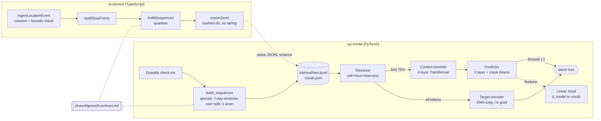

# JEPA Location World Model

[](https://github.com/yuto-49/jepa-location-world-model/actions/workflows/ci.yml)

A self-supervised JEPA (Joint Embedding Predictive Architecture) model that learns representations of check-in trajectories and predicts where a person goes next, trained on the Gowalla dataset with PyTorch.

## Problem / motivation

Next-location prediction asks: given the places someone has visited, where are they going next? Predicting raw cell IDs directly means a 53K-way classification problem over sparse, noisy labels. JEPA instead predicts the *latent representation* of the masked future part of a trajectory, using an EMA target encoder. The model learns how trajectories are structured without needing labeled destinations, and a small head can then turn that representation into a cell prediction.

## What I built

- **Data pipeline** (`py-model/data/`): loads Gowalla check-ins, quantizes lat/lng to a ~1 km integer grid, builds 7-day trajectories per user, splits train/val/test by user, applies k-anonymity, and exports JSONL plus a train-only vocabulary.
- **JEPA model** (`py-model/model/`): a token embedder, a context encoder, an EMA target encoder, and a predictor that uses mask tokens.
- **Training** (`train.py`) logs collapse metrics. **Fine-tuning** (`finetune.py`) adds a linear head on top of the frozen model.
- **Evaluation** (`eval.py`): 4 baselines plus the JEPA variants, all scored with the same Top-1, Top-5, median km and P90 km metrics.
- **TypeScript ingestion side** (`ts-service/`): consent-gated location ingestion, stay-point clustering, geocell sequence building and a privacy-filtered JSONL export. It produces data in the same record schema the Python model reads. It does not serve the model.
- **Shared contract** (`shared/geocell-contract.md`): one quantization spec that both languages implement. A parity test with 1000 fixtures checks that they agree.



## Approach

- **Tokens:** each check-in is embedded as `cell_emb + hour_emb(24) + dow_emb(7) + sinusoidal position` (`model/tokenizer.py`). `d_model=128`, `max_len=64`.
- **Masking:** each trajectory is split by time. The first `max(1, int(0.75 * len))` tokens are context and the rest are targets (`data/dataset.py`). The model predicts the future, not random spans.
- **Context encoder:** a pre-norm `nn.TransformerEncoder` with 4 layers and 4 heads that sees only the context tokens. The target encoder starts as a `deepcopy` of it, never receives gradients, sees all real tokens, and is followed by a LayerNorm.
- **Predictor:** a 2-layer Transformer. It overwrites the target positions with a learned mask token and predicts their latents.
- **Loss:** `F.smooth_l1_loss` between the predicted and target latents at the target positions.
- **EMA:** momentum rises linearly from 0.996 to 0.999 over training (`train.get_momentum`).
- **Optimization:** AdamW (lr 1e-3, weight decay 0.01), warmup of up to 500 steps followed by a cosine schedule, gradient clipping at 1.0, batch size 64, 30 epochs. The checkpoint with the best validation loss is kept.
- **Collapse monitoring:** every step logs `emb_std` (mean per-dimension std of the target latents) and `pred_target_cos`.
- **Fine-tuning:** all JEPA weights are frozen. Only a `Linear(128, vocab_size)` head is trained with cross-entropy, for 10 epochs at lr 3e-3.
- **Data:** Gowalla from Stanford SNAP (`data/load_gowalla.py`). Users with fewer than 10 check-ins are dropped, and cells visited by fewer than 5 distinct training users become `<UNK>`. A Foursquare TSMC2014 loader and a synthetic generator for that format are also included, but `build_sequences.py` currently uses only Gowalla.

## Key engineering decisions

- **Predict latents, then probe.** Pretraining uses a pure JEPA objective. Turning latents into cell IDs is a separate step, with either a nearest-neighbour search in latent space or a frozen-backbone linear head, so that step can be evaluated on its own.
- **Split by user, vocabulary from train only.** No user appears in more than one split (`data/splits.py` asserts this), and k-anonymity counts and the vocabulary come only from the training split. This keeps test users and test-only cells from leaking into training.
- **Baselines from the start.** Popularity, per-user popularity, recency and a first-order Markov model run through the same eval harness, so any JEPA number has a reference point.
- **Collapse metrics from step 1.** JEPA can collapse to a constant embedding, so `emb_std` is logged throughout training instead of being checked afterwards.
- **One contract for both languages.** The TypeScript ingestion and the Python model both depend on the same `g_{iy}_{ix}` cell IDs. A shared spec plus a 1000-pair parity fixture, read by both `pytest` and `vitest`, catches drift between them.
- **Privacy built into the data.** Exported records contain only geocells, the hour and the day of week. User IDs are salted SHA-256 hashes. Ingestion rejects events with missing or outdated consent.

## Results

These numbers come from the results log in `SPEC.md`. The checkpoints and processed data are gitignored, so they are not in this repo. All metrics are on the user-held-out test split.

The rows are not scored the same way. The baselines and the latent nearest-neighbour row score only the **first** target token of each trajectory. The linear-head row (`evaluate_jepa_cls`) scores **every** target token.

| Model | Top-1 | Top-5 | Median km | P90 km |
|-------|-------|-------|-----------|--------|
| Popularity (global) | 0.137 | 0.137 | 0.0 | 0.0 |
| Recency (last cell) | 0.237 | 0.237 | 3.1 | 58.9 |
| Markov (1st order) | 0.244 | 0.408 | **2.8** | **52.6** |
| JEPA (latent nearest neighbour) | 0.017 | 0.035 | 599.1 | 8320.4 |
| JEPA + frozen linear head | **0.246** | **0.426** | 3.3 | 82.7 |

What this shows:

- **Nearest-neighbour decoding over all 53K cells did not work.** Root causes are written up in `SPEC.md`: there is no classification objective, the search has no candidate filtering, the lookup used hour=0 and dow=0, and trajectories average about 4 tokens.
- **A single linear head on frozen JEPA features edges past the Markov baseline,** by 0.2 points on Top-1 and 1.8 points on Top-5. Because of the scoring difference above, treat this as an early signal, not a settled win.
- **Distance errors are worse,** especially P90, because nothing in the head favours geographically nearby cells.

## Run it

```bash
cd py-model
python -m venv venv && source venv/bin/activate
pip install -r requirements.txt

# 1. Data: put loc-gowalla_totalCheckins.txt in data/raw/
#    (https://snap.stanford.edu/data/loc-gowalla_totalCheckins.txt.gz)
python -m data.build_sequences      # -> data/processed/{train,val,test}.jsonl, vocab.json

python -m train                     # JEPA pretraining -> checkpoints/best.pt
python -m finetune                  # linear head      -> checkpoints/best_cls.pt
python -m eval                      # baselines + JEPA table
python -m visualize                 # UMAP of learned cell embeddings

python -m pytest -q                 # unit tests
```

```bash
cd ts-service
npm ci && npm test                  # vitest, including the cross-language geocell parity test
```

## Project structure

```
shared/geocell-contract.md   quantization + JSONL schema both languages implement
py-model/
  data/        loaders (Gowalla, Foursquare), geocell, splits, build_sequences, Dataset
  model/       tokenizer, encoder, predictor, jepa (EMA + loss + cls head)
  baselines/   popularity, recency, markov
  train.py  finetune.py  eval.py  visualize.py
  tests/       dataset, model, splits, geocell parity (+ fixtures/)
ts-service/
  src/         ingestion, episodes (stay points), sequence, geocell, export
  tests/       geocell-parity.test.ts
SPEC.md        full design notes and run history
```

## What I'd do next

- Score every model on the same target tokens, so the head-vs-Markov comparison is like for like.
- Fine-tune end to end, with the encoders unfrozen. The current head is a linear probe on frozen features.
- Restrict the softmax to geographically nearby candidate cells to bring down the P90 km error.
- Add time-gap embeddings and use longer, overlapping history windows. Today's trajectories average about 4 tokens.
- Bring `shared/geocell-contract.md` in line with the code. The contract still lists `CELL_SIZE_DEG = 0.005`, while both implementations use `0.01`.
